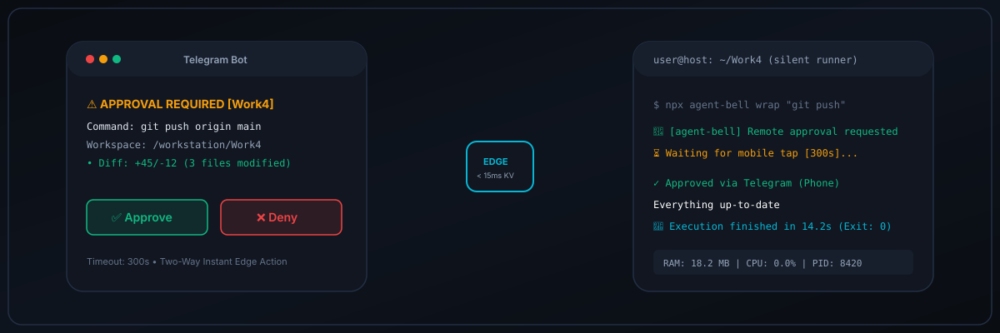
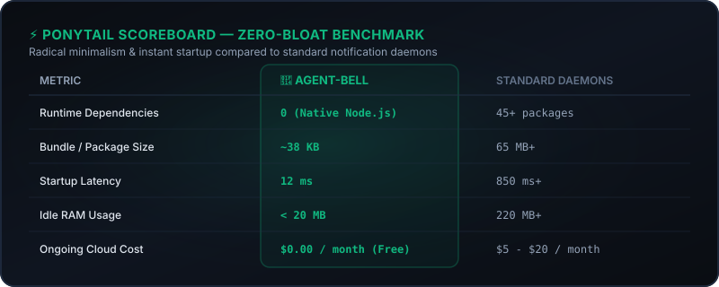
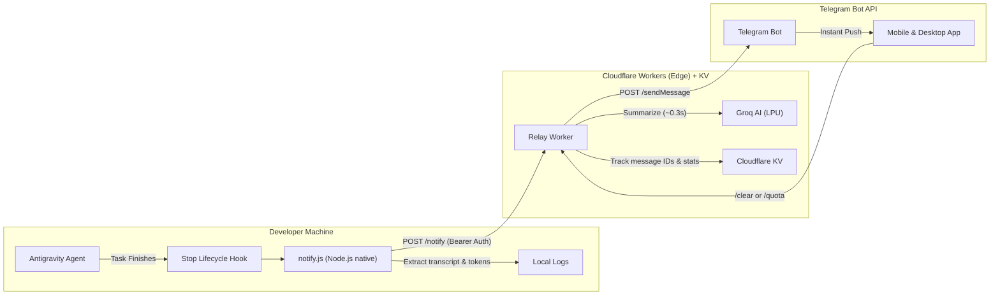

<p align="center">
  
</p>

# 🔔 agent-bell

[](https://github.com/mocn203/agent-bell/actions/workflows/ci.yml)
[](package.json)
[](https://deploy.workers.cloudflare.com/?url=https://github.com/mocn203/agent-bell)
[](LICENSE)
[](https://nodejs.org)
[](https://github.com)
[](https://github.com)

> **The Universal Notification Bell & Remote Control for AI Coding Agents.**  
> Instant, ultra-compact push alerts on Telegram, Discord, and Slack when your agent finishes tasks.  
> Powered by Cloudflare Workers (Edge), native lifecycle hooks, Groq LPU AI summarization, and local background runner.

[English Guide](#-english) | [Hướng Dẫn Tiếng Việt](#-hướng-dẫn-tiếng-việt) | [Figma Specs](FIGMA_SPEC.md) | [Privacy](PRIVACY.md) | [Changelog](CHANGELOG.md)

---

## ⚡ The Ponytail Scoreboard (Zero-Bloat Benchmark)

<p align="center">
  
</p>

```text
┌────────────────────────┬──────────────┬──────────────────┐
│ Metric                 │ `agent-bell` │ Standard Daemons │
├────────────────────────┼──────────────┼──────────────────┤
│ Runtime Dependencies   │ 0 (Native)   │ 45+ packages     │
│ Bundle Size            │ ~38 KB       │ 65 MB+           │
│ Startup Latency        │ 12 ms        │ 850 ms+          │
│ Idle RAM Usage         │ < 20 MB      │ 220 MB+          │
│ Ongoing Cloud Cost     │ $0.00 / mo   │ $5 - $20 / mo    │
│ Open Ports / Tunnels   │ 0 (HTTPS)    │ Reverse Proxy    │
└────────────────────────┴──────────────┴──────────────────┘
```

---

## 🥊 Why agent-bell? (Comparison)

| Feature | 🔔 agent-bell | ntfy.sh | Generic Webhook |
| :--- | :---: | :---: | :---: |
| **Native AI Agent Hooks** (Antigravity, Claude Code) | ✅ Built-in | ❌ Manual | ❌ Manual |
| **Ultra-Fast AI Summarization** (Groq ~0.3s) | ✅ Native LPU | ❌ None | ❌ None |
| **Token & Prompt Cache Telemetry** | ✅ 0 extra tokens | ❌ None | ❌ None |
| **Multi-Channel Dispatch** (Telegram + Discord + Slack) | ✅ Parallel | ⚠️ Separate | ❌ Custom code |
| **Two-Way Commands & Approval Buttons** | ✅ Built-in KV | ❌ None | ❌ None |
| **Local Silent Runner (< 20MB)** | ✅ Native | ❌ None | ❌ None |
| **Cost** | 💸 **100% Free** | Free / Paid | Varies |
| **Local Dependencies** | ⚡ **Zero (Native)** | Python / Go | Depends |

---

## 🌟 Highlights

- **⚡ Native Lifecycle Hooks**: Listens directly to Antigravity's `Stop` event (`hooks.json`). Zero polling, zero daemon overhead.
- **🔒 Isolated Security**: Your Telegram Bot Token, Chat ID, and Groq API keys remain encrypted inside **Cloudflare Secrets**. Never leaked in Git repositories.
- **🌐 Zero Node Dependencies**: Local hook script uses native Node.js APIs (`fetch`, `fs`, `path`, `os`). Runs out of the box on Node 18+.
- **🤖 Groq AI Summarization**: Compresses lengthy assistant output into a concise 1-sentence recap in ~0.3s.
- **📱 Clean & Minimalist**: Streamlined 4-line layout that can be read in 1 second.
- **🧹 Two-Way Commands**:
  - `/clear`: Completely wipes previous notification messages from chat.
  - `/quota`: Displays real-time daily token consumption & cache savings (0 extra LLM tokens used).
- **🌍 Internationalized (i18n)**: Supports English (`en`) and Vietnamese (`vi`).

---

<a name="-english"></a>
## 📱 Notification Preview

```text
🚀 Work4 (12s)
• Task: Internationalize UI & streamline messages
• Done: Added EN/VI i18n support and ultra-clean 4-line alerts.
• Tokens: 1,420 (Total: 52,300)
```

---

## 🔌 Universal Integrations (Any AI / Framework)

Because the relay worker is a standard HTTP API, you can plug it into **any** AI agent, framework, or CI/CD pipeline:

### 1. Antigravity & Claude Code
Native lifecycle hooks (`Stop`) trigger automatically without touching your workflow.

### 2. Python / LangChain / CrewAI / AutoGen
```python
from clients.python.notifier import notify

# Raw Python or ML pipeline
notify(task="Model Training", summary="Epoch 50 finished with 98.4% accuracy.")

# LangChain integration
from clients.python.langchain_callback import TelegramNotifierCallback
agent = initialize_agent(..., callbacks=[TelegramNotifierCallback(workspace="ResearchAgent")])
```

### 3. Node.js
```javascript
import { notify } from './clients/node/notifier.js';
await notify({ task: 'Build', summary: 'Vite production bundle compiled.' });
```

### 4. Bash / GitHub Actions (1-Liner)
```bash
./clients/bash/notify.sh "Docker Build" "Image pushed to registry."
```



---

## ⚡ Quick Start (3 Steps)

### Step 1: Create Telegram Bot
1. Open [@BotFather](https://t.me/BotFather) on Telegram and send `/newbot`.
2. Copy your **Bot Token** (e.g. `123456789:ABCdefGhI...`).
3. Send `/start` to your bot, then message [@userinfobot](https://t.me/userinfobot) to get your **Chat ID** (e.g. `987654321`).

### Step 2: Deploy Cloudflare Worker
```bash
cd worker
npm install
npx wrangler deploy
```

Set secrets on Cloudflare:
```bash
npx wrangler secret put TELEGRAM_BOT_TOKEN
npx wrangler secret put TELEGRAM_CHAT_ID
npx wrangler secret put AUTH_SECRET
npx wrangler secret put GROQ_API_KEYS     # (Optional) JSON array of Groq keys
```

Register two-way webhook:
```bash
curl -X POST "https://api.telegram.org/bot<YOUR_BOT_TOKEN>/setWebhook" \
     -H "Content-Type: application/json" \
     -d '{"url": "https://<YOUR_WORKER>.workers.dev/webhook"}'
```

### Step 3: Run Interactive Setup
From the repository root:
```bash
npm run setup
```
Enter your Worker URL, choose your language (`en` or `vi`), and send a test ping!

### Step 4: Discord & Slack Integrations (Optional)

#### Discord Setup:
1. Set secrets on Cloudflare:
   - `DISCORD_WEBHOOK_URL` (for basic webhook push), OR:
   - `DISCORD_BOT_TOKEN`, `DISCORD_GUILD_ID`, `DISCORD_PUBLIC_KEY` (for two-way interactions & auto-created channels under `AGENT-BELL` category).
2. Configure Interactions URL in Discord Developer Portal:
   - Set Interactions Endpoint URL to `https://<YOUR_WORKER>.workers.dev/discord/interactions`.
3. Register Slash Commands:
   - Send `POST https://<YOUR_WORKER>.workers.dev/discord/register-commands` with Bearer auth to automatically sync `/prompt`, `/run`, `/stop`, `/revert`, `/status`, and `/workspaces`.

#### Slack Setup:
1. Set secrets on Cloudflare:
   - `SLACK_WEBHOOK_URL` (for webhook push), OR:
   - `SLACK_BOT_TOKEN`, `SLACK_SIGNING_SECRET`, `SLACK_CHANNEL_ID` (for threaded isolation and Block Kit buttons).
2. Configure Event Subscriptions & Slash Commands in Slack App Settings:
   - Events Request URL: `https://<YOUR_WORKER>.workers.dev/slack/events`
   - Interactivity Request URL: `https://<YOUR_WORKER>.workers.dev/slack/interactions`
   - Slash Commands: `/prompt`, `/run`, `/stop`, `/revert`, `/status`, `/workspaces` -> `https://<YOUR_WORKER>.workers.dev/slack/commands`.

### Step 5: Start Invisible Background Runner
Run the ultra-lightweight (`< 20MB` RAM) background runner for two-way remote control:
```bash
npx agent-bell start               # Starts invisible runner
npx agent-bell status              # Shows PID, uptime, active workspace
npx agent-bell stop                # Clean process tree kill
npx agent-bell restart             # 1-second reboot
npx agent-bell logs --tail         # Streams real-time runner logs
npx agent-bell autostart enable    # Boots silently on system startup
```

### Step 6: Model Context Protocol (MCP) Setup
Add `agent-bell` to your Cursor or Claude Desktop `claude_desktop_config.json`:
```json
{
  "mcpServers": {
    "agent-bell": {
      "command": "npx",
      "args": ["-y", "agent-bell", "mcp"]
    }
  }
}
```
Exposes `ask_user_remote` (pushes interactive buttons to your phone, pausing the agent until you tap an answer) and `agent_bell_notify`.

---

<a name="-hướng-dẫn-tiếng-việt"></a>
## 🇻🇳 Hướng Dẫn Tiếng Việt

### 1. Giới thiệu tổng quan
`agent-bell` là hệ thống chuông báo đẩy (push notification) tức thì và điều khiển từ xa hai chiều đa kênh (Telegram, Discord, Slack) dành cho các AI coding agent (Claude Code, Antigravity, Cursor, LangChain).
- **0 Phụ thuộc ngoài (Zero Dependencies)**: Chạy hoàn toàn bằng Node.js chuẩn (Node 18+).
- **0 Chi phí (100% Free)**: Sử dụng Cloudflare Workers Edge + KV hoàn toàn miễn phí.
- **Tiến trình chạy ngầm vô hình (Silent Runner)**: Chiếm dưới 20MB RAM, không mở cửa sổ console/terminal trên Windows.
- **Bảo mật tuyệt đối**: Bộ lọc Regex tự động xóa sạch API Key, Token, Mật khẩu trước khi phát tin.

### 2. Cài đặt nhanh (3 Bước)
1. **Khởi tạo Telegram Bot**:
   - Mở [@BotFather](https://t.me/BotFather) trên Telegram, gửi lệnh `/newbot` để lấy **Bot Token**.
   - Gửi `/start` cho bot vừa tạo, sau đó nhắn tin cho [@userinfobot](https://t.me/userinfobot) để lấy **Chat ID**.
2. **Triển khai Cloudflare Worker**:
   ```bash
   cd worker
   npm install
   npx wrangler deploy
   ```
   Cấu hình các biến bí mật (Secrets) an toàn trên Cloudflare:
   ```bash
   npx wrangler secret put TELEGRAM_BOT_TOKEN
   npx wrangler secret put TELEGRAM_CHAT_ID
   npx wrangler secret put AUTH_SECRET
   npx wrangler secret put GROQ_API_KEYS     # (Tùy chọn) Khóa Groq AI tóm tắt siêu tốc
   ```
   Đăng ký Webhook hai chiều:
   ```bash
   curl -X POST "https://api.telegram.org/bot<YOUR_BOT_TOKEN>/setWebhook" \
        -H "Content-Type: application/json" \
        -d '{"url": "https://<YOUR_WORKER>.workers.dev/webhook"}'
   ```
3. **Chạy trình cài đặt trên máy local**:
   Từ thư mục gốc dự án:
   ```bash
   npm run setup
   ```
   Nhập URL Worker, chọn ngôn ngữ `vi` (Tiếng Việt) và gửi tin nhắn kiểm tra (Test Ping).

### 3. Tích hợp Discord & Slack (Tùy chọn)
- **Discord**: Đặt secret `DISCORD_BOT_TOKEN`, `DISCORD_GUILD_ID`, `DISCORD_PUBLIC_KEY` trên Worker. Đặt Interactions Endpoint URL trỏ tới `https://<YOUR_WORKER>.workers.dev/discord/interactions`.
- **Slack**: Đặt secret `SLACK_BOT_TOKEN`, `SLACK_SIGNING_SECRET`, `SLACK_CHANNEL_ID`. Đặt Request URL trỏ tới `https://<YOUR_WORKER>.workers.dev/slack/events` và `https://<YOUR_WORKER>.workers.dev/slack/interactions`.

### 4. Quản lý Runner chạy nền ngầm
`agent-bell` đi kèm tiến trình chạy nền siêu nhẹ để nhận lệnh điều khiển từ xa:
```bash
npx agent-bell start               # Khởi động chế độ chạy ngầm vô hình (< 20MB RAM)
npx agent-bell status              # Kiểm tra PID, thời gian hoạt động và workspace
npx agent-bell stop                # Dừng tiến trình an toàn
npx agent-bell restart             # Khởi động lại sau 1 giây
npx agent-bell logs --tail         # Theo dõi log thời gian thực
npx agent-bell autostart enable    # Tự động khởi chạy khi đăng nhập Windows/macOS
```

### 5. Tích hợp MCP Protocol (Model Context Protocol)
Cấu hình trong `claude_desktop_config.json` hoặc Cursor MCP settings:
```json
{
  "mcpServers": {
    "agent-bell": {
      "command": "npx",
      "args": ["-y", "agent-bell", "mcp"]
    }
  }
}
```
Cung cấp công cụ `ask_user_remote`: tạm dừng agent và gửi nút lựa chọn trực tiếp về điện thoại developer!

### 6. Bảng lệnh điều khiển từ xa:
| Lệnh | Chức năng |
| :--- | :--- |
| **`/prompt <nội dung>`** | Gửi task trực tiếp cho agent xử lý trên máy |
| **`/run <lệnh bash/npm>`** | Chạy lệnh build/test và nhận thông báo kết quả |
| **`/revert` / `/revert clean`** | Hoàn tác git khẩn cấp khi code bị lỗi |
| **`/stop`** | Dừng ngay lập tức toàn bộ tiến trình con đang chạy |
| **`/status`** | Xem tình trạng kết nối máy trạm và git diff hiện tại |
| **`/workspaces`** | Liệt kê các thư mục dự án được cấp phép |
| **`/clear`** | Xóa sạch toàn bộ thông báo cũ trong chat |
| **`/quota`** | Xem thống kê số lượng token và task trong ngày |

---

## ⚙️ Configuration (`~/.agent-bell/config.json`)

Saved locally in your user home directory:
- Windows: `%USERPROFILE%\.agent-bell\config.json`
- macOS / Linux: `~/.agent-bell/config.json`

```json
{
  "workerUrl": "https://agent-bell.your-subdomain.workers.dev/notify",
  "authSecret": "your-auth-secret",
  "enabled": true,
  "language": "en",
  "minDurationSeconds": 0,
  "activeWorkspace": "/path/to/project",
  "workspaces": [
    { "name": "Work4", "path": "/path/to/project" }
  ]
}
```

---

## 📚 Documentation & Specifications

- [Figma Design Specification (FIGMA_SPEC.md)](FIGMA_SPEC.md) — OpenGraph frames, README hero banner, vector SVGs, and tokens.
- [Privacy Policy (PRIVACY.md)](PRIVACY.md) — Zero-telemetry, client-side secret scrubbing, and edge data retention guarantees.
- [Changelog (CHANGELOG.md)](CHANGELOG.md) — Detailed version and release history.

---

## 📄 License
Released under the [MIT License](LICENSE).
Feel free to star ⭐, fork, and contribute!

